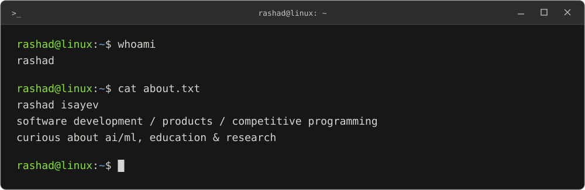

  

i build web applications, develop products, and practice competitive programming. i enjoy working through a problem from the initial idea to the interface, api, and database behind it.

i'm interested in ai/ml, education, entrepreneurship, and independent research. i spend a lot of my time reading, experimenting, and figuring out how things work.

### tools i work with

[rashadisayev.dev](https://rashadisayev.dev)
